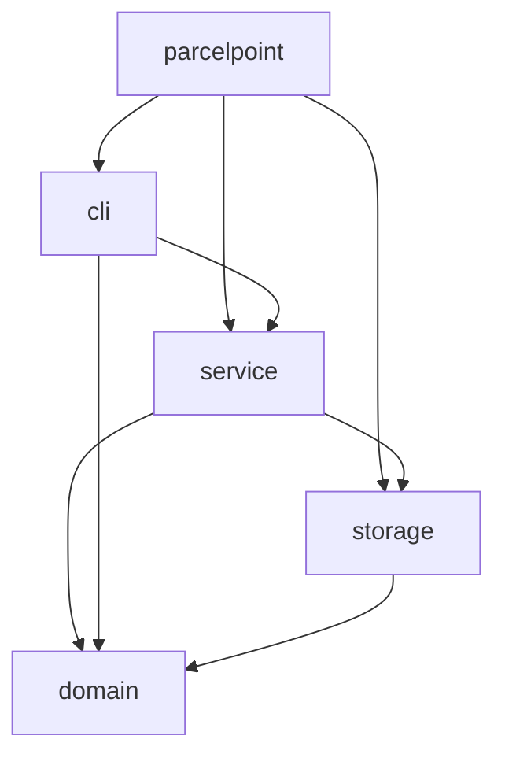
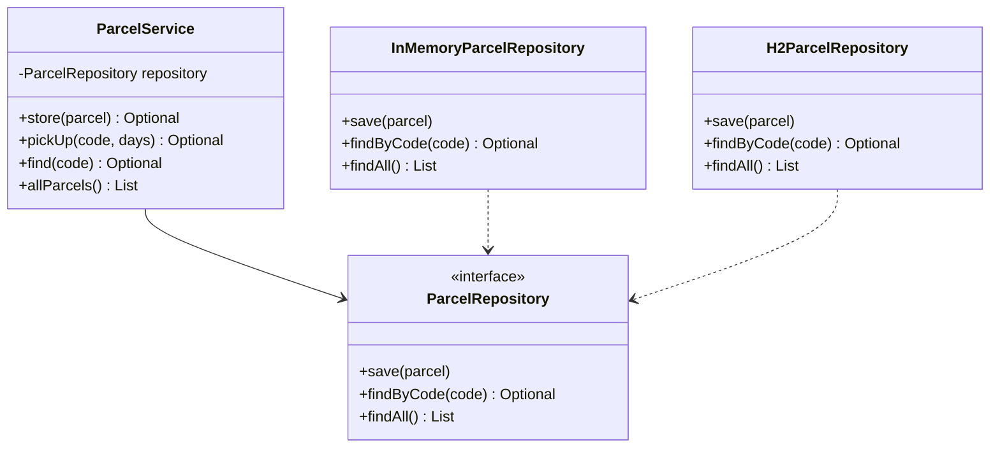
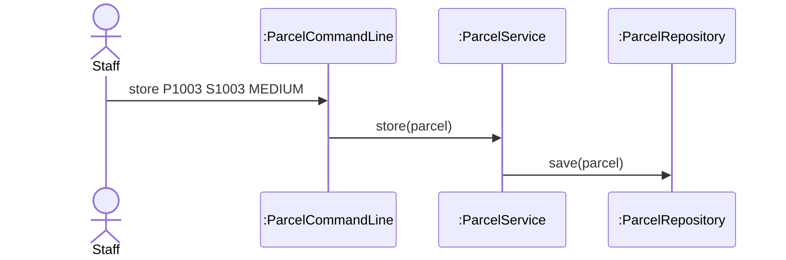

# Lab Report, Designing the Data Management Layer with H2

Repository URL: [GitHub Link](https://github.com/Sakkaraj/itcs382-h2-lab)

## Tools

| Item | Version or name |
| --- | --- |
| JDK | 27.0.1.0.3 |
| Maven | 3.10.0 |
| IDE | Cursor |
| AI tool and exact model, if you used one | Grok 4.6 (Medium) |

## Part 0. From a store in memory to H2

Commit of the starter, before any change:

0.3 Your prediction for `staff`, written before the second run:

Output of the second run, for `staff` and `quit`:

```text
> staff
Free lockers: 3
> quit
```

State in one sentence where you think the parcels of the first run were kept.

0.5 The line of Main that you would change to keep the parcels somewhere else:

```java
ParcelRepository repository = new H2ParcelRepository("./data/parcelpoint");
```

0.6 Commit of the switch to H2:

0.7 Output of `SELECT * FROM PARCEL;` after you stored two parcels:

```text
CODE  | STUDENT_ID | PARCEL_SIZE | STATUS | LOCKER_NUMBER
P1001 | S1001      | SMALL       | STORED | 1
P1002 | S1002      | LARGE       | STORED | 3
```

0.8 Explain why ParcelPoint could not start while the H2 Shell was open, and identify the class that wrote the message `Cannot create the PARCEL table`.
**Answer:** H2 in file mode lets only **one process** open `./data/parcelpoint` at a time. While the H2 Shell holds that lock, ParcelPoint cannot connect. Startup still runs `new H2ParcelRepository(...)`, which tries `CREATE TABLE IF NOT EXISTS PARCEL` and fails. That exception is caught and rethrows as `IllegasStateException("Cannot create the PARCEL table")` in **`H2ParcelRepository`**

0.9 Explain why `staff` shows no parcel while `find` shows each one, and why all three lockers look free.
**Answer:** `findAll` in `H2ParcelRepository` is still a stub (`return List.of();`). `staff` prints `allParcels()`, which calls `findAll()`, so no parcel appear.

0.11 Your findAll method:

```java
@Override
    public List<Parcel> findAll() {
        String sql = "SELECT * FROM PARCEL";
        try (Connection connection = connect(); PreparedStatement statement = connection.prepareStatement(sql); ResultSet row = statement.executeQuery()){
            List<Parcel> parcels = new ArrayList<>();
            while (row.next()) {
                parcels.add(toParcel(row));
            }
            return parcels;
        } catch (SQLException e) {
            throw new IllegalStateException("Cannot read all parcels", e);
        }
    }
```

Commit that adds findAll:

0.12 Output of `SELECT * FROM PARCEL;` after the pickup:

```text
CODE  | STUDENT_ID | PARCEL_SIZE | STATUS    | LOCKER_NUMBER
P1001 | S1001      | SMALL       | PICKED_UP | null
P1002 | S1002      | LARGE       | STORED    | 3
```

0.13 Optional. Describe what `find P9999'OR'1'='1` showed while the SQL was joined from strings, and what it showed after you put the placeholder back.
**Answer:** When using a joined from strings to form a SQL query, the `find P9999'OR'1'='1` injects the input and forms the `SELECT * FROM PARCEL WHERE CODE = 'P9999'OR'1'='1'` which will always matches every row. The `findByCode` sill takes only the first row of the `row.next()`, so the command line will show the results of the existing parcel, not "no parcel with code P9999'OR'1'='1". When using the place holder `?`, the quote and `OR` stay inside the value. The H2 will looks for a parcel whose code is literally `P9999'OR'1'='1`, and it does not exist, so the result on the CLI is "No parcel with code P9999'OR'1'='1".

## Part A. Model the design

A1 Complete the flowchart with one node for each package and one arrow for each dependency, from the package that uses to the package that is used. Mark the package that accesses the data store.



State whether cli depends on storage, and explain why.
**Answer:** CLI does not depends on the storage, it uses only `ParcelService` and `domain`. `Main` in `parcelpoint` is what constructs the `H2ParcelRepository` and passes it in.

A2 Complete the class diagram of the data management layer with ParcelService, the interface ParcelRepository with its three operations, and the two classes that implement it.



A3 Draw a sequence diagram for the command `store P1003 S1003 MEDIUM`, from the staff member to the repository. Show each message as an operation of the class that receives it.



Explain why the last lifeline is the interface ParcelRepository rather than H2ParcelRepository.
**Answer:** The `ParcelService.store` calls the `repository.save(...)` on the interface type. At runtime, that object is an `H2ParcelRepository`, but the design does not douple the service to H2.

## Part B. Design questions

1. Identify the files that you changed to move from the store in memory to H2, and explain why no other class had to change. Use the terms of this course.
**Answer:** I only changed the [`Main.java`](/parcelpoint-h2/src/main/java/parcelpoint/Main.java) to construct `H2ParcelRepository` instead of `InMemoryParcelRepository` (plus `findAll` later on in [`H2ParcelRepository.java`](/parcelpoint-h2/src/main/java/parcelpoint/storage/H2ParcelRepository.java)). The `ParcelCommandLine`, `ParcelService` and `domain` stayed the same, because they depend on the `ParcelRepository` abstraction, not on a concrete store.

2. The PARCEL table stores the size of a parcel as SMALL, MEDIUM or LARGE rather than as 1, 2 or 3. Identify the type of connascence between ParcelSize and the table in each case, and explain which one is weaker.
**Answer:**
- Names in table (`SMALL`, `MEDIUM`, `LARGE`) matching `ParcelSize` names: connascence of name
- Integers `1`, `2`, `3` meaning those sizes: connascence of meaning
Name is weaker (better), both sides share the same identifier. Meaning is stronger, both must agree that `1` means small, which is easy to get wrong and harder to see.

3. Project Phase 2 asks for a data store that needs no separate server. Explain why an embedded database such as H2 meets this rule, and describe the limit of an embedded database that Step 0.8 showed.
**Answer:** H2 is embedded, it runs inside the same JVM as ParcelPoint, so you do not install or start a separate database server. Step 0.8 showed the limit, a file-mode embedded DB is locked by one process. The shell and the app cannot both open `./data/parcelpoint` at once.

4. State the data store that you would choose for your Project Phase 2 team, files or an embedded database, the requirement that drives the choice, and the package that will access it.
- Embedded database (H2) if queries, ACID updatas, and data that survives restart is needed, and still without a server.
- Storage is the only package that should access it.

## AI usage declaration

| AI tool and exact model | Date | Purpose | Files or answers it produced or changed | How you checked its output |
| --- | --- | --- | --- | --- |
|Grok 4.6 (Medium) in Cursor|2026-11-09|Explain Part 0|[`LAB_REPORT.md`](/LAB_REPORT.md), [`H2ParcelRepository.java`](/parcelpoint-h2/src/main/java/parcelpoint/storage/H2ParcelRepository.java)|Rebuilt with mvn package, ran the jar, ran `java "@h2shell.txt"` and `SELECT * FROM PARCEL;`, confirmed `staff/find` after `findAll`.|
|Grok 4.6 (Medium) in Cursor|2026-11-13|Draft Part A diagrams and Part B answers|[`LAB_REPORT.md`](/LAB_REPORT.md) A1-A3 mermaid and B1-B4|Checked package imports for A1, `ParcelRepository` for A2, `store` call chain for A3, and B matches `Main`/0.8/`ParcelSize`|
